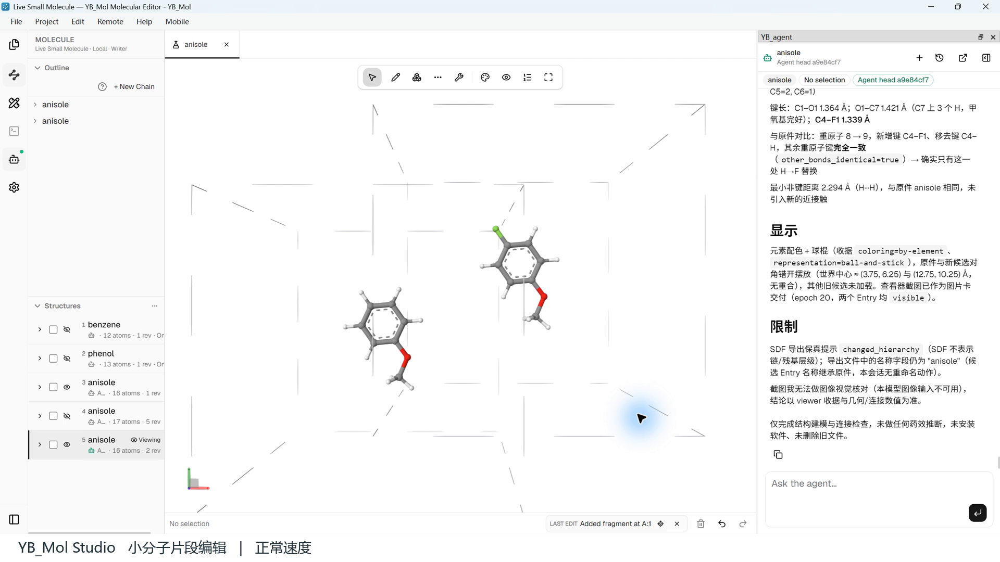

<p align="right"><strong>English</strong> | <a href="README_zh-CN.md">简体中文</a></p>

# YB_MOL Studio

**See, edit and refine molecular structures together with an AI agent.**

YB_MOL Studio is a desktop workspace for molecular and materials design. You and YB_Agent work on the same editable molecular objects: inspect a structure in 3D, make a precise change by hand or in natural language, compare candidates, and continue with scientific tools.

**[Download Windows preview](https://github.com/yanbo-mol/YB_Mol_agent/releases/download/v0.1.0-preview.656a16e02897/YB_Mol-0.1.0-win-64-UNSIGNED-656a16e02897.exe) · [Get started](docs/quickstart.md) · [Explore examples](examples/README.md) · [Report an issue](https://github.com/yanbo-mol/YB_Mol_agent/issues/new/choose)**

[Windows x64 preview](https://github.com/yanbo-mol/YB_Mol_agent/releases/tag/v0.1.0-preview.656a16e02897) · [ChemRxiv preprint](https://doi.org/10.26434/chemrxiv.15010106/v1) · [Website](https://ccbiomol.com/)

[](assets/demos/molecular-editing.mp4)

**[Watch the 64-second editing demo](assets/demos/molecular-editing.mp4)** — retain anisole, create a candidate and replace one para hydrogen with fluorine. Actual app recording prepared on 2026-10-05; the execution segment is accelerated 8×. [Recording details](assets/README.md).

## What makes the workspace useful

- **Direct molecular editing.** Inspect atoms, bonds, residues and chains, then change the structure yourself. Useful for researchers who prefer visual tools and experts who need hands-on control.
- **Human–agent collaboration.** Ask YB_Agent to make a local change, inspect the resulting object and continue editing it. The result remains a molecular structure you can work with.
- **Continuous design.** Keep a baseline, create candidates and compare revisions within a project before exporting a selected structure.
- **Connected computation.** Use configured scientific tools, model services and local or remote computing resources, with results and files available in the workspace.

The molecular-object core is `yb_mol`; YB_Agent operates through the platform's tools. Available tasks depend on the installed version, model connection and scientific environment.

## See concrete examples

| Example | What you can inspect |
| --- | --- |
| [Small-molecule editing](examples/molecular-editing/README.md) | Anisole → para-fluoroanisole; original and candidate shown together; real recording. |
| [Protein editing](examples/protein-editing/README.md) | 1UBQ A:11 Lys → Ala; a local side-chain change in the 3D workspace. |
| [Co₃O₄ crystal and surface modeling](examples/materials/README.md) | Bulk crystal → (112) surface supercell → toluene placement; downloadable structure files. |
| [RNA chemical modification](examples/rna-editing/README.md) | N6 methyl addition to a short RNA fragment; recorded structural result and export limitations. |

These are structural modeling examples. They do not establish improved activity, stability or catalytic performance. Historical recordings and the newer crystal files are dated individually; they are not a fresh acceptance test of the downloadable installer.

## Install and try

Current public build: **0.1.0 Windows x64 preview**, `v0.1.0-preview.656a16e02897`, published **2026-10-22**.

1. [Download the installer](https://github.com/yanbo-mol/YB_Mol_agent/releases/download/v0.1.0-preview.656a16e02897/YB_Mol-0.1.0-win-64-UNSIGNED-656a16e02897.exe) from the [release page](https://github.com/yanbo-mol/YB_Mol_agent/releases/tag/v0.1.0-preview.656a16e02897). The source-code ZIP is not an installer.
2. Install and launch the app. If an activation screen appears, follow the [installation and activation guide](docs/installation.md).
3. Open a structure and inspect it manually. To use YB_Agent, configure a provider in **Settings → Agent Models**, then try the [first editing task](docs/quickstart.md).

The installer is unsigned. Device authorization and third-party model/computing fees are separate from downloading the installer. See [installation](docs/installation.md) and [model setup](docs/model-configuration.md) for details.

## Help and feedback

[Quick start](docs/quickstart.md) · [Model setup](docs/model-configuration.md) · [FAQ](docs/faq.md) · [Website documentation](https://ccbiomol.com/docs/)

Use [GitHub Issues](https://github.com/yanbo-mol/YB_Mol_agent/issues/new/choose) for reproducible bugs and feature requests. For activation and research collaboration, contact [zhaoyanbo@ccbiomol.com](mailto:zhaoyanbo@ccbiomol.com) or [zhangshuai@ccbiomol.com](mailto:zhangshuai@ccbiomol.com). Report security issues privately using [SECURITY.md](SECURITY.md).

## Research and citation

**YB_Mol Studio: an agent-integrated visual editing platform for molecular and materials design**<br />
Yanbo Zhao, Shuai Zhang, Shenggang Li, Zezhong Miao, Haijiao Fu, Miaomiao Wang. ChemRxiv, 2026. [Read the preprint](https://doi.org/10.26434/chemrxiv.15010106/v1).

The publication title is retained as published. The preprint has not been peer reviewed.

```bibtex
@article{zhao2026ybmol,
  title   = {YB_Mol Studio: an agent-integrated visual editing platform for molecular and materials design},
  author  = {Zhao, Yanbo and Zhang, Shuai and Li, Shenggang and Miao, Zezhong and Fu, Haijiao and Wang, Miaomiao},
  journal = {ChemRxiv},
  year    = {2026},
  doi     = {10.26434/chemrxiv.15010106/v1}
}
```

## Repository scope

This is the public distribution, documentation and feedback repository for **YB_MOL Studio**. It does not contain the core application source code and is not an open-source release of that code. Software use is governed by the applicable product license; third-party datasets retain their own terms. See [contribution guidance](CONTRIBUTING.md) for documentation and feedback contributions.
