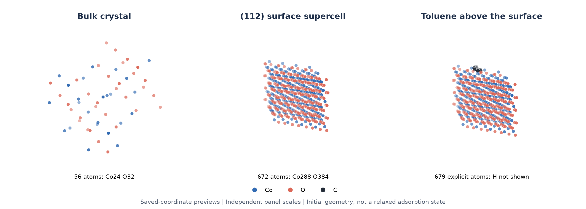

# Co₃O₄ crystal, surface and molecular placement / 晶体、表面与分子放置

[All examples / 案例目录](../README.md) · [Quick start / 快速上手](../../docs/quickstart.md)

This example extends the workspace from molecular editing to periodic materials: inspect a bulk crystal, construct a surface supercell and place a molecule above it. These are saved modeling outputs from 2026-10-27, not an adsorption-energy calculation.

这个案例展示周期材料建模：查看体相晶体、构建表面超胞、在表面放置分子。文件保存于 2026-10-27，展示结构构建与几何检查。

Coordinate rendering from the files below, with independent panel scales; not an app screenshot. [Rendering script](render_preview.py) (optional: gemmi, numpy, matplotlib). / 根据下列文件坐标绘制，各面板独立缩放，并非 App 截图。

## Downloadable structures / 可下载结构

| File / 文件 | Contents / 内容 |
| --- | --- |
| [Bulk Co₃O₄](files/Co3O4_COD_9005887.cif) | 56 atoms: Co24 O32; a = b = c = 8.0821 Å, α = β = γ = 90°. |
| [(112) surface supercell](files/co3o4_112_surface_2x1x1.cif) | 672 atoms: Co288 O384. |
| [Toluene](files/toluene.sdf) | Molecular input used for the surface placement example. |
| [Surface + toluene](files/Co3O4_112_toluene_physisorption.cif) | 679 explicit atoms: Co288 O384 C7. Toluene hydrogens are not explicit in this export. |
| [Recorded geometry checks](files/Co3O4_112_toluene_validation.json) | Distances and placement orientation recorded alongside the assembled structure. |

The bulk file is an application export identified as derived from [Crystallography Open Database entry 9005887](https://www.crystallography.net/cod/9005887.html), not an untouched copy of the database CIF. Its positions are explicitly expanded and its symmetry metadata is P1. Consult the source record for the original crystallographic provenance and symmetry. Third-party data retain their applicable terms.

体相文件是标记为来源于 COD 9005887 的应用导出文件，并非数据库原始 CIF。全部位置已展开，导出对称性元数据为 P1；原始晶体学出处和对称性以 COD 记录为准。

## Try it / 如何查看与继续建模

1. Download a CIF using GitHub's **Download raw file** control. Import it into a new project and show its Entry. / 通过 GitHub 的 Download raw file 下载 CIF，在新项目中导入并显示。
2. Rotate the bulk crystal; inspect its cell and atom counts. Open the surface file separately to compare. / 旋转体相晶体并检查晶胞和原子数，再单独打开表面文件比较。
3. Open the assembled file to inspect the molecule's position relative to the surface. / 打开组装文件，检查分子与表面的相对位置。
4. To repeat or vary the modeling with YB_Agent, [configure a model](../../docs/model-configuration.md) and state the desired surface and placement explicitly. / 配置 Agent 模型后，明确指定表面与放置要求。

Example request / 参考任务：

> 保留 Co₃O₄ 原始晶体。基于 (112) 表面创建 2×1 表面超胞，先说明切面、终止面与真空层选择，再显示候选。在表面上方放置甲苯，检查最短距离和明显碰撞，并导出各阶段 CIF。这里只做初始结构建模。

> Keep the original Co₃O₄ crystal. Propose the termination and vacuum spacing for a (112) 2×1 surface supercell, then show the candidate. Place toluene above the surface, check distances and obvious clashes, and export the stages as CIF files. This is initial structure modeling only.

This is a suggested task reconstructed from the saved outputs, not a transcript of the original conversation. Surface termination, vacuum spacing and molecular orientation require explicit choices; a prompt alone does not fully specify a slab.

这是依据保存结果整理的建议任务，不是原始会话逐字记录。终止面、真空层与分子取向需要明确选择，不能仅凭一个晶面指数认定模型唯一。

## Geometry and limits / 几何结果与范围

The saved report gives a minimum carbon-to-surface distance of 3.192 Å and no distance below its 2.5 Å hard-clash threshold. It reports the ring centroid 3.334 Å above the surface. These are placement checks, not evidence of a relaxed or stable adsorption state.

随结构保存的检查报告给出最短碳—表面距离 3.192 Å，未发现低于其 2.5 Å 阈值的硬碰撞，芳环中心高于表面 3.334 Å。这些是放置几何检查，不证明结构经过弛豫或具有稳定吸附态。

The filename contains “physisorption”, but no adsorption energy or catalytic performance result is supplied here. Add/verify hydrogens, force-field or electronic-structure settings, surface termination and cell conditions before simulation. Atom inventories were rechecked from the files during this documentation update; the original Agent workflow was not rerun.

文件名中的 physisorption 不代表已经计算物理吸附能。本案例没有提供吸附能或催化性能结果；用于模拟前需检查补氢、力场或电子结构设置、终止面和晶胞条件。本次文档整理重新核对了文件原子数，没有重新执行原 Agent 流程。
