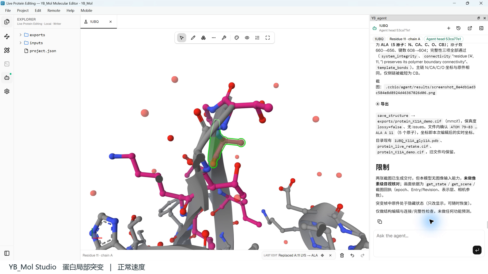

# Protein editing / 蛋白局部编辑

[All examples / 案例目录](../README.md)

## Input / 输入

Import [PDB 1UBQ](https://www.rcsb.org/structure/1UBQ), select chain A residue 11. / 导入 1UBQ，定位 A 链第 11 位。

To ask the Agent to repeat the workflow, install and activate the app as required and [configure an Agent model](../../docs/model-configuration.md). Manual viewing does not need an LLM. / 使用 Agent 重做需完成相应安装激活并配置模型；手动查看不需要大模型。

## Task / 任务

> 回到原始 1UBQ，保留原件并隐藏旧候选。定位 A:11 Lys，复制一个候选，突变为 Ala 后立即 view 新 Revision，并聚焦 A:11。导出 mmCIF。只做这一处突变，不插入残基，不做功能预测。

以已经打开的 1UBQ 为基线，将 A 链第 11 位 Lys 突变为 Ala。最终有效录像只演示一次突变，不包含残基插入。

## Recorded outcome / 历史记录结果

The recording record reports ALA 11 with N, CA, C, O and CB; 656 atoms in the exported structure.

导出文件包含 ALA 11 的 N、CA、C、O、CB 五个原子，总原子数为 656。

## What to inspect / 检查重点

Keep the baseline, inspect the selected site in 3D, and check the exported atom identities and connectivity. A natural-language completion message alone is insufficient. / 保留基线，查看三维位点，检查导出文件中的原子、残基和连接关系。

镜头开始时保留了上一轮局部视图，随后 Agent 返回原件再编辑。画面仍有邻近残基、卡通和水分子，属于实际工作视图，不是净化后的论文配图。此前插入 Gly 的试跑产物保留在项目中，但不作为本条视频完成内容。

## Provenance / 记录说明

From the demonstration package prepared on 2026-10-05. The installed build was not recorded in its manifest. Outcomes above are attributed to that record; this repository update has not rerun the Agent task, and the original exported structure is not bundled here. Screenshots retain their original UI and captions. See [asset notes](../../assets/README.md).

来自 2026-10-05 整理的演示资料，清单未记录当时安装包的构建编号。以上结果注明为该次记录，不表示本次重新执行了 Agent；本仓库未附这次演示的原始结构导出。截图保留当时界面和字幕。
