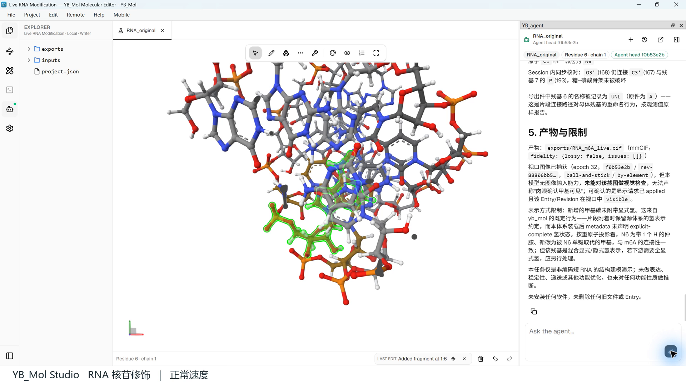

# RNA chemical modification / RNA 化学修饰

[All examples / 案例目录](../README.md)

## Input / 输入

This historical recording starts from an existing short noncoding RNA Entry. The original input and export are not bundled here. / 历史录像从已有非编码短 RNA Entry 开始，本仓库未附该原始输入与导出文件。

To ask the Agent to repeat the workflow, install and activate the app as required and [configure an Agent model](../../docs/model-configuration.md). Manual viewing does not need an LLM. / 使用 Agent 重做需完成相应安装激活并配置模型；手动查看不需要大模型。

## Task / 任务

> 基于 RNA_original 保留原件并复制候选。选择已有腺苷位点，用 yb_mol 和原生 Entry 在 N6 位连接甲基，修改后立即 view 并聚焦。检查糖和磷酸骨架连接，导出 mmCIF。仅做非编码短 RNA 结构建模，不做功能优化。

基于非编码短 RNA 片段，在一个腺苷的 N6 位连接甲基。可作为 mRNA 修饰建模相关功能的结构示例，但不是完整 mRNA 设计。

## Recorded outcome / 历史记录结果

The recording record reports an N6–C1 distance of about 1.469 Å, residue 6 exported as UNL, and 640 atoms overall. It is not a complete mRNA design or a standardized m6A residue export.

导出文件中第 6 位为 UNL。新增 C1 距 N6 约 1.469 Å，结构文件共 640 个原子。

## What to inspect / 检查重点

Keep the baseline, inspect the selected site in 3D, and check the exported atom identities and connectivity. A natural-language completion message alone is insufficient. / 保留基线，查看三维位点，检查导出文件中的原子、残基和连接关系。

本次导出没有使用标准 m6A 残基名，而是 UNL；新增甲基碳未附带全部显式氢。画面仍显示较多邻近原子，甲基特写不够突出。不能宣传为完整 mRNA、表达优化、递送优化或已经验证的生物功能设计。

## Provenance / 记录说明

From the demonstration package prepared on 2026-10-05. The installed build was not recorded in its manifest. Outcomes above are attributed to that record; this repository update has not rerun the Agent task, and the original exported structure is not bundled here. Screenshots retain their original UI and captions. See [asset notes](../../assets/README.md).

来自 2026-10-05 整理的演示资料，清单未记录当时安装包的构建编号。以上结果注明为该次记录，不表示本次重新执行了 Agent；本仓库未附这次演示的原始结构导出。截图保留当时界面和字幕。
